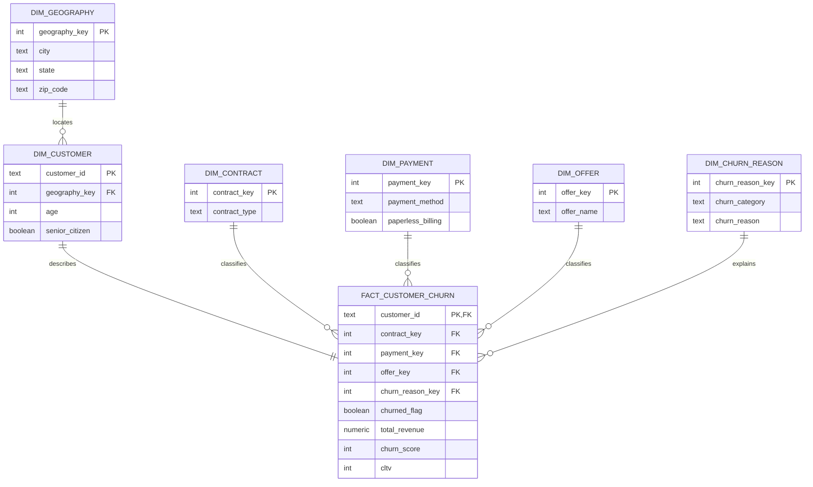

# Analytical data model

The model uses a star schema. `fact_customer_churn` has one record per customer in the supplied quarterly snapshot; every dimension filters that fact table in one direction.

## Why this design

- It separates stable customer descriptors from measurable churn outcomes.
- It makes contract, payment, offer, and churn-reason filters reusable in Power BI.
- It makes the grain explicit, preventing accidental double-counting of customers.
- It can later accept additional quarterly snapshots by adding an extract-date dimension and a snapshot key to the fact table.
